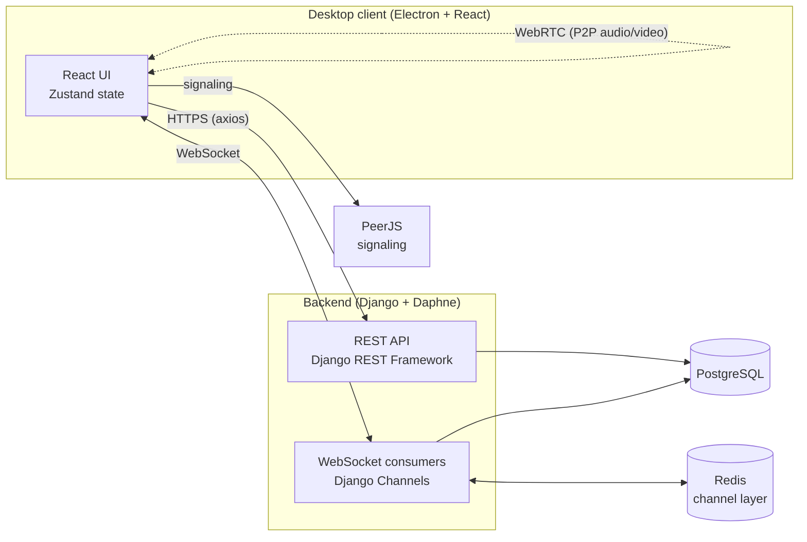

<div align="center">

# ChatApp

**A real-time desktop messenger with one-to-one chat, friend requests, presence, and peer-to-peer voice and video calls.**

Built as our university graduation project.


</div>

---

## Overview

ChatApp is a cross-platform desktop chat application. The client is an **Electron + React** app. The backend is a **Django** server that exposes a REST API for accounts, friends, and message history, and uses **Django Channels** WebSockets to deliver messages and notifications in real time. Voice and video calls go directly between users over **WebRTC**, using **PeerJS** for signaling.

## Features

- **Accounts:** registration, login, and logout with token-based (`Bearer`) authentication
- **Profiles:** profile photo, status message, and editable profile details
- **Friends:** send, accept, decline, and remove friend requests, with live notifications
- **Real-time messaging:** one-to-one chat over WebSockets, with persisted history and an emoji picker
- **Read receipts:** messages are marked as read when the recipient opens the conversation
- **Online presence:** see in real time which friends are online
- **Voice and video calls:** peer-to-peer audio and video calls over WebRTC (PeerJS)
- **Group chat (backend):** group creation, membership, and a group WebSocket channel are implemented on the server
- **Cross-platform:** the desktop app can be packaged for Windows, macOS, and Linux with `electron-builder`

## Architecture



| Layer | Technologies |
| --- | --- |
| Desktop client | Electron, React 18, TypeScript, Tailwind CSS, Zustand, React Router, Axios |
| Real-time | Django Channels, Daphne (ASGI), Redis channel layer, WebSockets |
| Calls | WebRTC, PeerJS |
| Backend API | Django 5, Django REST Framework, token authentication |
| Database | PostgreSQL |
| Tooling | Webpack, ESLint, Jest, Docker, Docker Compose |

## Project Structure

```
chat_app/
├── frontend/                 # Electron + React desktop client
│   ├── src/
│   │   ├── main/             # Electron main process (window, menu, preload)
│   │   └── renderer/         # React app
│   │       ├── pages/        # Login, Register, Chat
│   │       ├── components/   # Sidebar, chat panel, profile, friends, notifications
│   │       ├── context/      # Call and notification providers
│   │       ├── store/        # Zustand chat store
│   │       └── utils/        # API client, WebSocket and PeerJS helpers
│   └── package.json
│
└── server/                   # Django backend
    ├── config/               # Settings, ASGI/WSGI, routing, middleware
    ├── chat_app/
    │   ├── models.py         # User, Profile, Message, Friendship, ChatGroup, GroupMessage
    │   ├── views/            # REST endpoints (auth, messages, friends, groups, calls)
    │   └── consumers/        # WebSocket consumers (messages, notifications, groups)
    ├── Dockerfile
    ├── docker-compose.yml
    └── requirements.txt
```

## Getting Started

### Prerequisites

- **Node.js** 20 or 22 (LTS) and npm
- **Python** 3.11
- **PostgreSQL**
- **Redis** on `127.0.0.1:6379`
- **Docker** (optional; the easiest way to run Redis and PostgreSQL)

### 1. Backend

```bash
cd server

# Start Redis and PostgreSQL (or use locally installed services)
docker run -d --name chat-redis -p 6379:6379 redis:7
docker run -d --name chat-postgres -p 5432:5432 \
  -e POSTGRES_DB=chat_app -e POSTGRES_USER=chat_app -e POSTGRES_PASSWORD=chat_app \
  postgres:16

# Create a virtual environment and install dependencies
python3.11 -m venv .venv
source .venv/bin/activate          # Windows: .venv\Scripts\activate
pip install -r requirements.txt

# Configure the database connection
cp .env.example .env               # then edit the values if needed

# Set up the database and start the ASGI server
python manage.py migrate
python manage.py createsuperuser   # optional, for the Django admin
daphne -b 0.0.0.0 -p 8000 config.asgi:application
```

The API is now available at `http://localhost:8000`.

### 2. Desktop client

By default the client connects to our hosted test server. To use your local backend, change these base URLs to `http://localhost:8000` and `ws://localhost:8000`:

- `frontend/src/renderer/utils/apiClient.ts`: REST API base URL
- `frontend/src/renderer/pages/Chat.tsx`: message WebSocket
- `frontend/src/renderer/context/NotificationContext.tsx`: notification WebSocket

Then install the dependencies and start the app:

```bash
cd frontend
npm install
npm start
```

### 3. Packaging

```bash
cd frontend
npm run package            # builds an installer for the current OS (AppImage on Linux)
npm run build:installer    # builds a Windows installer
```

Installers are written to `frontend/release/build/`.

## API Overview

### REST endpoints

| Method | Endpoint | Description |
| --- | --- | --- |
| `POST` | `/registration/` | Create an account |
| `POST` | `/login/` | Log in and receive an auth token |
| `POST` | `/logout/` | Log out |
| `PUT` | `/edit-profile/` | Update profile, photo, and status |
| `GET` | `/users/` | List users |
| `POST` | `/message/` | Send a direct message |
| `POST` | `/read-messages/<username>` | Mark a conversation as read |
| `GET` | `/friends/` | List friends |
| `POST` | `/send-friend-request/` | Send a friend request |
| `POST` | `/accept-friend-request/` | Accept a friend request |
| `POST` | `/decline-friend-request/` | Decline a friend request |
| `GET` | `/pending-friend-requests/` | List incoming requests |
| `POST` | `/delete-friend/` | Remove a friend |
| `POST` | `/create-group/` | Create a group chat |
| `POST` | `/add-group-member/<id>/` | Add a member to a group |
| `POST` | `/start-call/`, `/end-call/` | Signal the start and end of a call |

Authenticated requests send the header `Authorization: Bearer <token>`.

### WebSocket channels

| Path | Purpose |
| --- | --- |
| `ws/message/<user_id>/` | Incoming direct messages |
| `ws/notification/<user_id>/` | Friend requests, presence, and call events |
| `ws/group/<group_id>/` | Group chat messages |

## Team

| | |
| --- | --- |
| **Berat Doğan** | [github.com/beratdogan6](https://github.com/beratdogan6) |
| **cemilcan0** | [github.com/cemilcan0](https://github.com/cemilcan0) |

## License

This project is licensed under the [MIT License](LICENSE).

The desktop client is based on [Electron React Boilerplate](https://github.com/electron-react-boilerplate/electron-react-boilerplate), which is also MIT licensed (see `frontend/LICENSE`).
